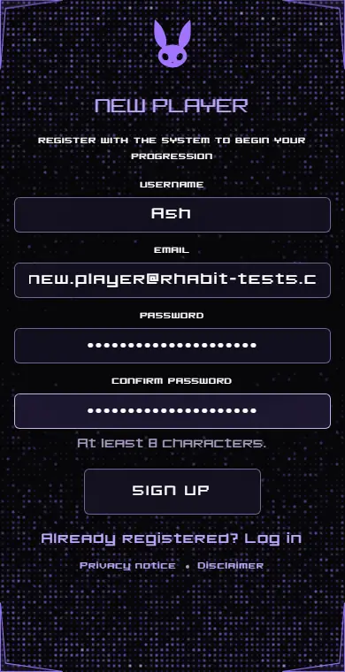

# Rhabit

A gamified daily habit tracker: finish your tasks inside a daily window to earn XP and level up, or face a penalty.

**[Try the live demo](https://rhabit-habit-tracker.vercel.app/demo)** · [Live site](https://rhabit-habit-tracker.vercel.app) · [Source code](https://github.com/4shwotts/Rhabit-Habit-Tracker)

[](https://github.com/4shwotts/Rhabit-Habit-Tracker/actions/workflows/ci.yml)


---

## 1. What it is

Rhabit turns daily habits into a game, styled like the menus in isekai anime, with a penalty system modelled on Solo Levelling. You set up goal pathways, such as Fitness or Study, with tasks for each level. Each day you get three tasks and a time window. Finish and confirm them in time to earn XP, or miss the window and face a penalty challenge. The higher you level, the harder the tasks and the shorter the window.

It's a full-stack portfolio project: a React frontend, an Express API, a PostgreSQL database, and a test suite that runs on every push.

---

## 2. Try the demo

**[Open the live demo](https://rhabit-habit-tracker.vercel.app/demo)**, or press **Try the demo** on the login page. One click gives you a throwaway account, with no sign-up, email or password.

- **It starts part-way through the game.** A Fitness pathway sits at level 4 with XP in its bar, next to Study and Art pathways at other levels. Today's tasks are already started, with one ticked.
- **Its timers are fast,** so you can see everything in a few minutes. The daily window is 3 minutes, with Confirm opening after 1 minute. A missed window starts a 2-minute penalty. The server sets these from the account; full accounts keep their normal timings.
- **It's deleted after 24 hours,** or straight away when you log out or choose End demo in Settings.
- **The first visit can take up to a minute,** because the free server sleeps when idle. The app says it's waking the server, and offers a retry if it can't be reached.

Demo accounts can't set up two-step sign-in or trigger any email. Each IP address can start 5 demos an hour, and at most 200 can exist at once.

---

## 3. Features

**The game**
- **Goal pathways:** several habits (Fitness, Art, Study and so on), each with its own XP and level.
- **Daily windows:** three tasks a day, inside a window set by the hardest task: 3 hours for levels 1–3, 2 hours for 4–6, 90 minutes for 7–9 and 1 hour for level 10. Confirm unlocks 30 minutes before the end.
- **XP and levels:** 15 XP per task, 100 XP per level, up to level 10. Each level unlocks a harder tier of tasks. A full bar at level 10 completes the pathway.
- **Penalties:** a window that ends without a confirm starts a 1-hour penalty challenge. Failing it costs 45 XP. Closing the site doesn't dodge it: unfinished days and days the app isn't opened are settled at the next reset.
- **Rerolls, pausing and goal switching:** swap a task for 10 XP, pause progression for a break, and switch pathways mid-day with today's tasks remembered.
- **Time zones:** each player's day resets at their own midnight.

**Accounts**
- Email verification, password reset and optional authenticator-app two-step sign-in with backup codes.
- A one-click demo, as above.
- A privacy notice and disclaimer, readable without logging in.

**Phones**
- Every page has its own small-screen layout, upright or sideways, checked in Chromium and in WebKit (the engine behind Safari).

The full sign-up flow, recorded locally against the test setup (the email comes from the test outbox, and nothing here touches the live site):



Public sign-up is closed on the live site, so the demo is the way in.

---

## 4. Tech stack

| Area | Tools |
|---|---|
| Frontend | React 19, Vite, React Router 7, plain CSS (no UI or animation libraries) |
| Backend | Node.js 24, Express 5, zod validation, helmet, express-rate-limit |
| Database | PostgreSQL on Neon, via `pg`, with SQL migrations |
| Accounts | JWT sessions in httpOnly cookies, bcrypt, TOTP two-step sign-in, Brevo for email |
| Testing | Vitest, Testing Library, Supertest, Playwright (Chromium and WebKit), axe |
| Hosting and CI | Vercel (frontend), Render (API), GitHub Actions |

---

## 5. Architecture and key design decisions

```
Browser (React)
    |  same-origin /api requests, session in an httpOnly cookie
    v
Vercel (static frontend, rewrites /api to the backend)
    |
    v
Render (Express API: validation, rate limits, game rules)
    |                    \
    v                     v
Neon (PostgreSQL)      Brevo (email)
```

- **The server decides everything that matters.** XP, levels and timers are worked out on the server from stored timestamps. The browser only displays them, and strict validation refuses any extra fields it sends.
- **Each day is settled in a locked transaction.** Every daily route first brings the day up to date with the clock, so a closed tab can't dodge a missed window or a penalty, and a double-click can't confirm twice.
- **Every row belongs to a user.** Queries filter by owner, so another player's data looks as if it doesn't exist.
- **Demo accounts are safe by construction.** A database rule ties a demo to its expiry date and an address that can never receive mail, so the clean-up can't match a real account. Expired demos are cleared when the server starts, every hour, and whenever a new demo begins.
- **Sign-up can be closed without a code change.** `PUBLIC_SIGNUP_ENABLED=false` makes the server refuse sign-ups, while existing accounts keep working.
- **Tests can never reach real data.** They use their own throwaway database, ignore the real connection string, and refuse hosted database addresses before any test starts.
- **A sleeping server isn't mistaken for a broken one.** The login page calls `/api/wake` as it loads, to wake the server and database early. Slow requests show a waking message, and failed ones offer a retry.

---

## 6. Testing

**445 automated tests**, all run by GitHub Actions on every push and pull request:

| Level | Tests | What they cover |
|---|---|---|
| Unit | 103 | Game rules, demo accounts, and proof the tests can't reach the real database |
| Component | 49 | Home timers and penalty pop-up, sign-up page, privacy pages, server wake-up and retry |
| Image size | 32 | Every image and icon stays under 200 kB |
| API integration | 235 | Real HTTP requests against a real Postgres database: authentication, security, validation, two-factor, authorisation, game rules, rate limits, demo, sign-up switch, wake-up |
| Browser journeys | 9 | The main player journeys and the demo, end to end in Chromium |
| Accessibility | 1 | An axe scan of every main page against WCAG 2.1 A and AA, with 0 violations |
| Phone checks | 16 | Every main page and the demo at four phone and tablet sizes, in Chromium and WebKit |

Server coverage is 90.8% of lines. **[TESTING.md](TESTING.md)** has the strategy, the full breakdown, what's deliberately not tested, and how to run it all on Windows.

Developed with AI-assisted tooling (Claude Code). Test strategy, review, manual exploratory testing and bug triage by me.

---

## 7. Bugs found and fixed

**[BUGS.md](BUGS.md)** writes up 16 real bugs, each with steps to reproduce, root cause, fix and the test that now guards it. Some highlights:

- **Logging out left a copied session cookie working,** found by reviewing the API tests. Logout now ends the session on the server.
- **The midnight reset erased punishments,** so closing the site dodged an XP loss. Found in code review.
- **A huge XP amount hung the server,** found by unit tests on the level maths.
- **Safari lost a button's shape and the Goals list spilled out of its frame,** found by testing on a real iPhone after the automated Chromium checks had passed. This is why the phone checks now run in WebKit too.

---

## 8. How to run it locally on Windows

You need Node.js 24 and npm. Run these in PowerShell.

**Install:**
```powershell
git clone https://github.com/4shwotts/Rhabit-Habit-Tracker.git
cd Rhabit-Habit-Tracker
npm install
npm install --prefix server
npx playwright install chromium webkit
```

**Try it without any setup.** This starts a throwaway database, the API and the website together:
```powershell
node e2e/stack.mjs
```
Open http://localhost:5181 and press Ctrl+C to stop; everything is deleted. Sign-ups here use 30-second test timers, and emails go to a test outbox instead of being sent.

**Run the tests:**
```powershell
npm test              # unit, component, image and API tests
npm run test:coverage # the same, with coverage reports
npm run test:e2e      # browser journeys, accessibility and phone checks
```

**Run it against your own database:**
1. Copy `server/.env.example` to `server/.env` and fill in `DATABASE_URL`. A free Neon branch works.
2. Create the tables:
   ```powershell
   npm run migrate --prefix server
   ```
3. Double-click `start.bat`, or run `npm run dev --prefix server` and `npm run dev` in two windows.
4. Open http://localhost:5173. Without a Brevo key, emails such as verification links are printed in the server window.

---

## 9. Known limitations

- **The first request can be slow.** The free server sleeps when idle and can take up to a minute to wake. The app shows a waking message and a retry, but it can't make the wait shorter.
- **Rate limits are kept in memory.** They reset when the server restarts and wouldn't be shared across several server instances.
- **Logging out signs you out on every device.** There's no per-device session list.
- **Countdowns use the device's clock,** so a badly wrong clock shows the wrong time left. The server stays in charge of what's allowed, with a 5-second allowance.
- **Clock-change days are slightly off early in the day.** Time left until midnight assumes a 24-hour day, so it's an hour out before the clocks change. It's correct near midnight, when it matters.
- **Testing has limits.** Browser tests run in Chromium, plus WebKit for the phone checks, not on real devices. Real iPhones are checked by hand. There's no load testing and no visual regression testing, and the security tests are my own, not an independent audit.
- **Frontend unit coverage is modest,** at about a third of lines, because most pages are tested end to end in the browser, which doesn't count towards that figure.

---

## 10. Privacy

The live site has a **[privacy notice](https://rhabit-habit-tracker.vercel.app/privacy)** and a **[disclaimer](https://rhabit-habit-tracker.vercel.app/disclaimer)**. In short:
- demo accounts hold no real personal data, send no emails and are deleted after 24 hours
- the only cookie keeps you logged in
- there's no analytics or tracking
